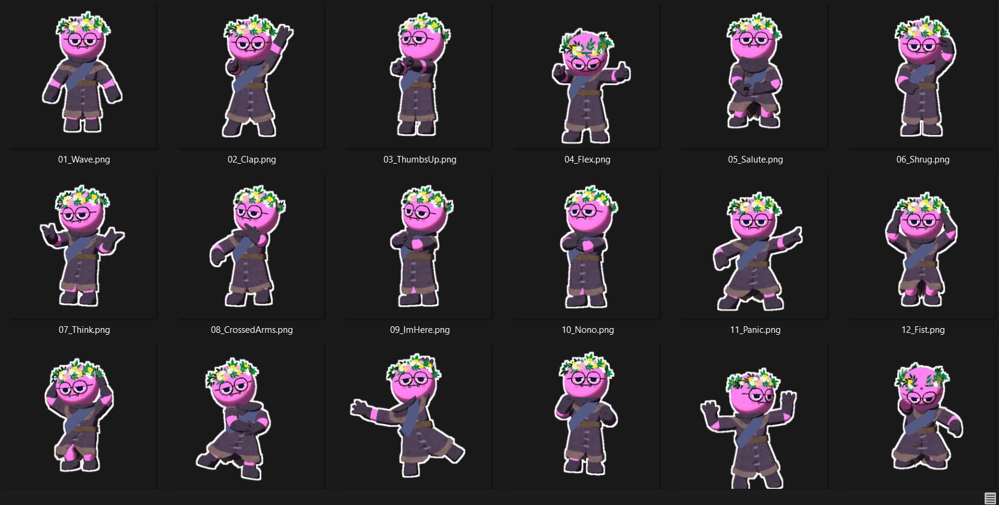
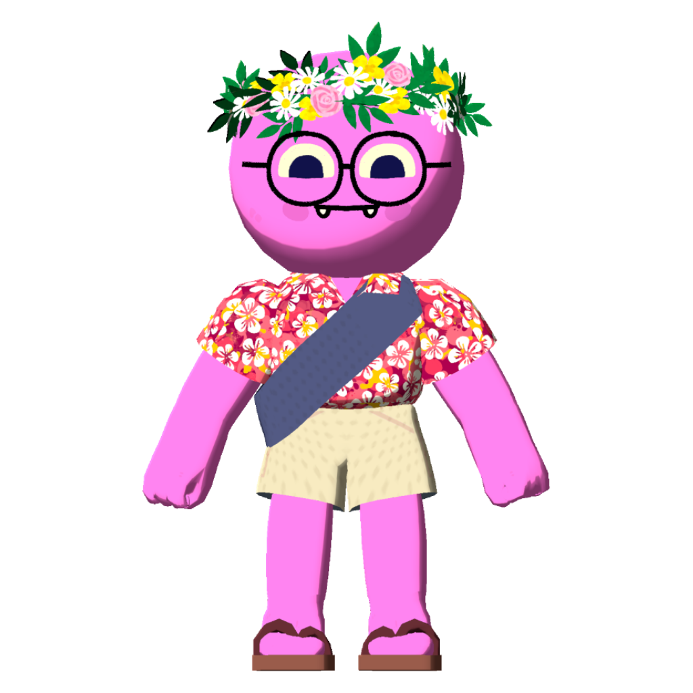
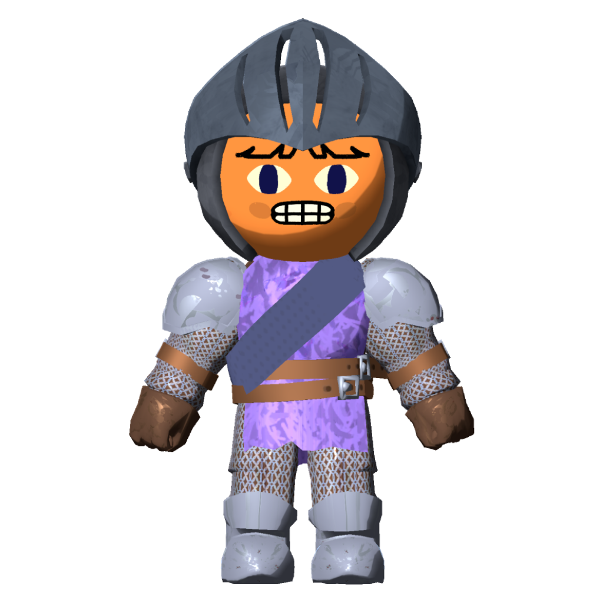
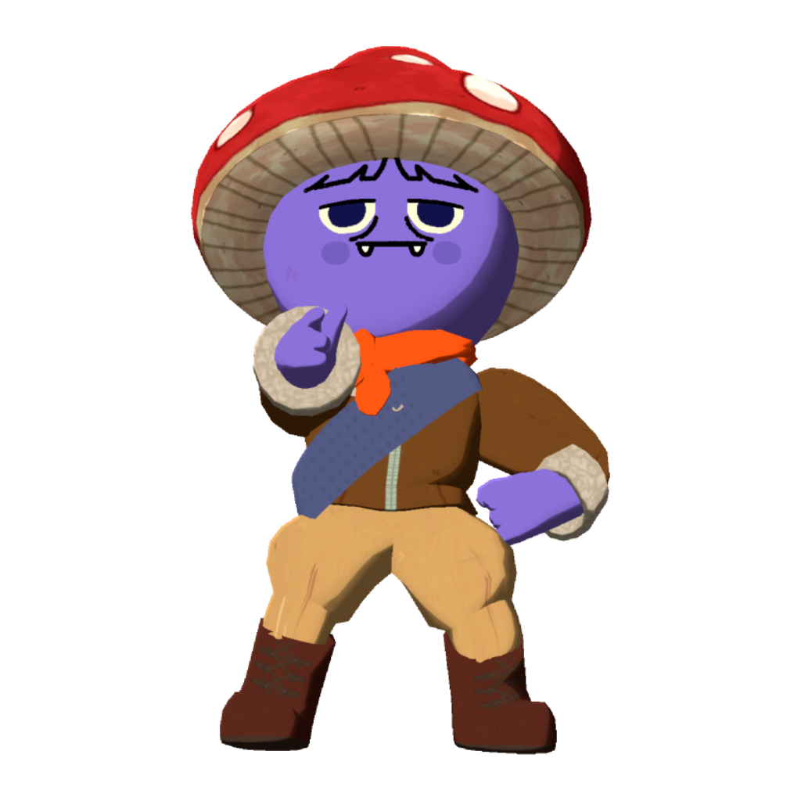
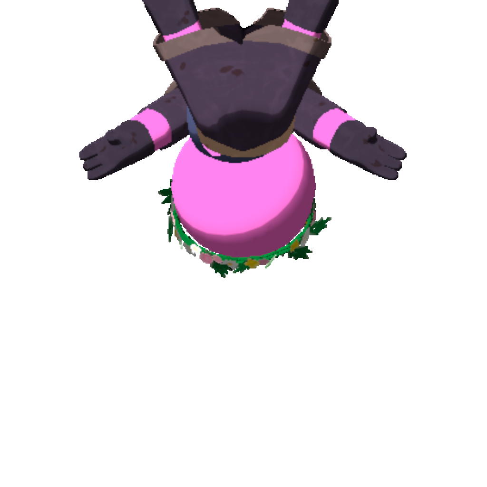
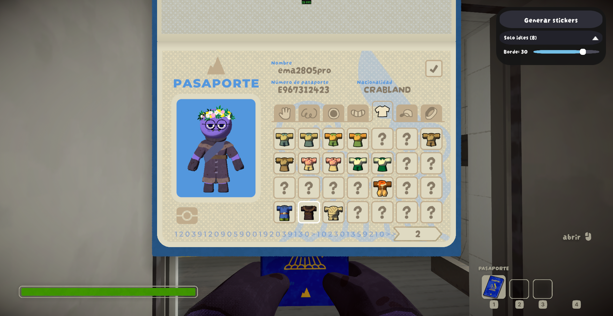

<div align="center">
<h1>Peak Stickers</h1>

  
[](https://thunderstore.io/c/peak/p/CoolShitREN/PeakStickers)  
**English** · [Español](https://github.com/ema28pro/Peak-Stickers/blob/main/README_ES.md)
</div>


[](https://github.com/ema28pro/Peak-Stickers/tree/main/img/examples)

| I'm Here | Shrug | Idle 2 | BackFlip |
| :---: | :---: | :---: | :---: |
|  |  |  |  |


Generate **PNG stickers of your PEAK character with their outfit**, in **every pose**, with a **transparent background** and the classic **white sticker border**.

You can see all available poses in the [`img/examples`](https://github.com/ema28pro/Peak-Stickers/tree/main/img/examples) folder.

## How does it work?

1. Open your **customization notebook** (the passport) in-game.
2. You'll see a new **"Generar stickers"** button in the top-right corner.
3. Click it: the mod captures your character's 3D model in every pose (all 22 emote wheel emotes + 8 idle pose variants) and saves one PNG per pose.
4. The stickers are saved to **`Pictures\PEAK Stickers\<date>`**.

Each sticker is exported in high quality (rendered at 2× and downscaled), with no background and a smooth white border around the character.



## Requirements

- [BepInExPack PEAK](https://thunderstore.io/c/peak/p/BepInEx/BepInExPack_PEAK/) (automatic dependency on Thunderstore).

## Configuration

Optional: edit `BepInEx/config/ema28pro.PeakStickers.cfg`

| Option | Default | Description |
| --- | --- | --- |
| `OutputDirectory` | *(empty)* | Output folder. Empty = `Pictures/PEAK Stickers`. |
| `OpenFolderWhenDone` | `false` | Open the output folder when finished. |
| `Resolution` | `1024` | Size of each sticker in pixels (512/1024/2048). |
| `BorderWidth` | `12` | Width of the white border in pixels. |
| `IncludeIdlePoses` | `true` | Include the 8 idle pose variants. |
| `SampleTimes` | *(table)* | Sample frame (0..1) per pose. E.g.: `BackFlip=0.45;PlayDead=0.95`. |

### Fine-tuning poses

Each animation has a "sample frame": poses that end in a held position (collapsing, sitting, etc.) are captured **at the end** of the animation, while acrobatic ones (backflip) are captured **at an intermediate frame**. If a pose doesn't look the way you want, adjust its value in `SampleTimes` and generate again.

## Building (optional)

```sh
dotnet build -c Release
```

The Thunderstore package is output to `./artifacts/thunderstore/`. Requires [.NET SDK 10](https://dotnet.microsoft.com/download) and the game installed (to reference its assemblies).

## Credits

- Built with the [official PEAK mod template](https://github.com/PEAKModding/BepInExTemplate).
