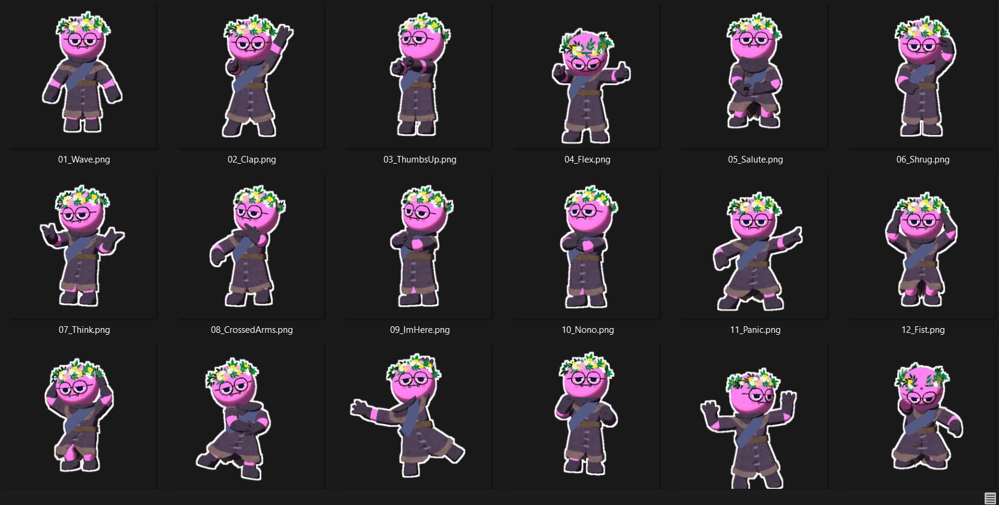
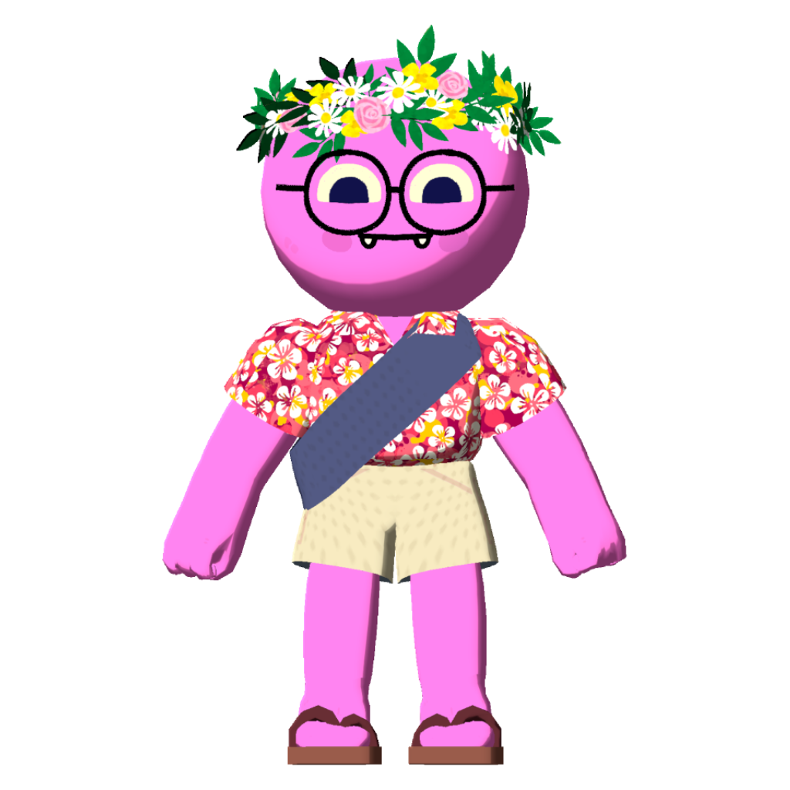
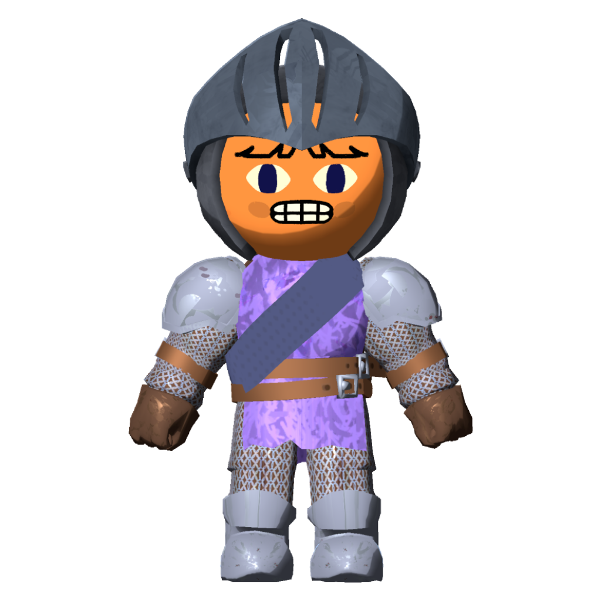
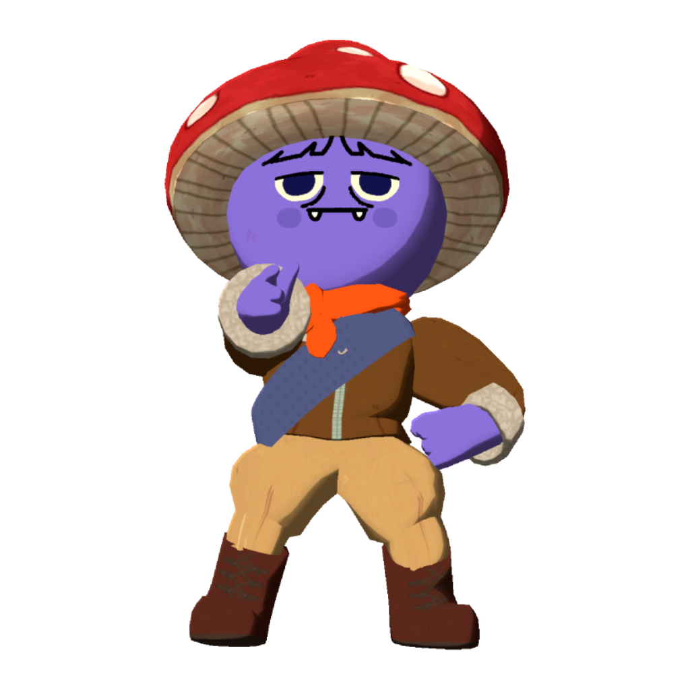
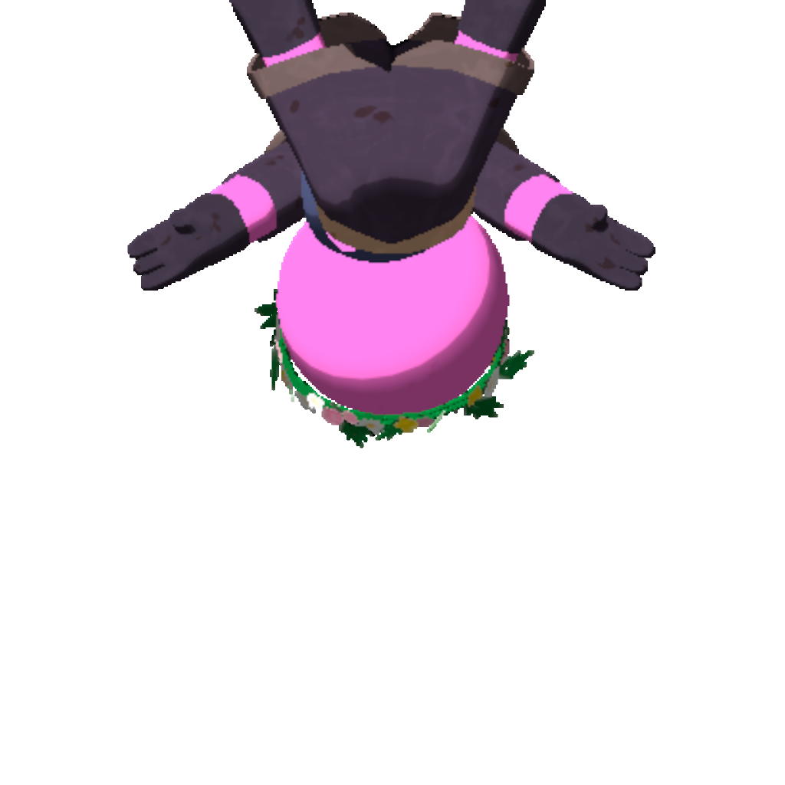
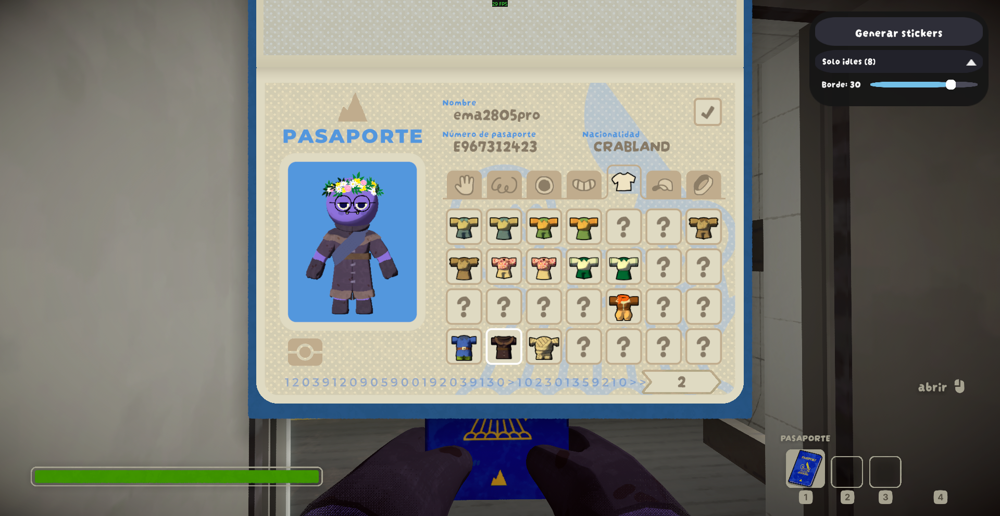

<div align="center">
<h1>Peak Stickers</h1>

 
[](https://thunderstore.io/c/peak/p/CoolShitREN/PeakStickers)  
**English** · [Español](https://github.com/ema28pro/Peak-Stickers/blob/main/README_ES.md)
</div>

[](https://github.com/ema28pro/Peak-Stickers/tree/main/img/examples)

| I'm Here | Shrug | Idle 2 | BackFlip |
| :---: | :---: | :---: | :---: |
|  |  |  |  |


Genera **stickers PNG de tu personaje de PEAK con su ropa**, en **todas las poses**, con **fondo transparente** y el típico **borde blanco** de sticker.

Puedes ver todas las poses disponibles en la carpeta [`img/examples`](https://github.com/ema28pro/Peak-Stickers/tree/main/img/examples).

## ¿Cómo funciona?

1. Abre tu **libreta de customización** (el pasaporte) en el juego.
2. Verás un botón nuevo **"Generar stickers"** en la esquina superior derecha.
3. Dale clic: el mod captura al modelo 3D de tu personaje con todas sus poses (los 22 emotes de la rueda de emotes + las 8 variantes de pose idle) y guarda un PNG por pose.
4. Los stickers se guardan en **`Mis Imágenes\PEAK Stickers\<fecha>`**.

Cada sticker sale en alta calidad (renderizado a 2× y reescalado), sin fondo, con borde blanco suave alrededor del personaje.



## Requisitos

- [BepInExPack PEAK](https://thunderstore.io/c/peak/p/BepInEx/BepInExPack_PEAK/) (dependencia automática en Thunderstore).

## Configuración

Opcional: edita `BepInEx/config/ema28pro.PeakStickers.cfg`

| Opción | Por defecto | Descripción |
| --- | --- | --- |
| `OutputDirectory` | *(vacío)* | Carpeta de salida. Vacío = `Mis Imágenes/PEAK Stickers`. |
| `OpenFolderWhenDone` | `false` | Abrir la carpeta al terminar. |
| `Resolution` | `1024` | Tamaño de cada sticker en píxeles (512/1024/2048). |
| `BorderWidth` | `12` | Grosor del borde blanco en píxeles. |
| `IncludeIdlePoses` | `true` | Incluir las 8 variantes de pose idle. |
| `SampleTimes` | *(tabla)* | Frame (0..1) de cada pose. Ej: `BackFlip=0.45;PlayDead=0.95`. |

### Ajuste fino de las poses

Cada animación tiene un "frame de muestra": las poses que terminan en una posición (derrumbarse, sentarse, muñequito) se toman **al final** de la animación, y las acrobáticas (voltereta) **en un fotograma intermedio**. Si alguna pose no sale como la quieres, cambia su valor en `SampleTimes` y vuelve a generar.

## Compilación (opcional)

```sh
dotnet build -c Release
```

El paquete para Thunderstore queda en `./artifacts/thunderstore/`. Requiere [.NET SDK 10](https://dotnet.microsoft.com/download) y el juego instalado (para referenciar sus ensamblados).

## Créditos

- Hecho con la [plantilla oficial de mods de PEAK](https://github.com/PEAKModding/BepInExTemplate).
